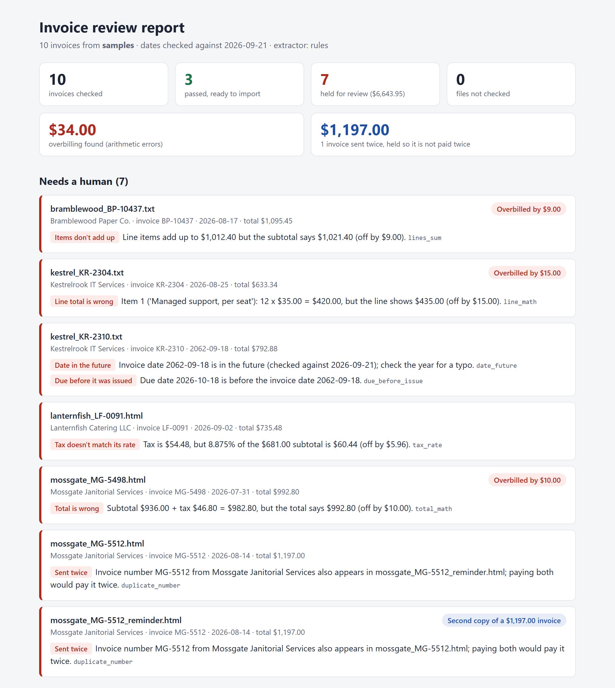
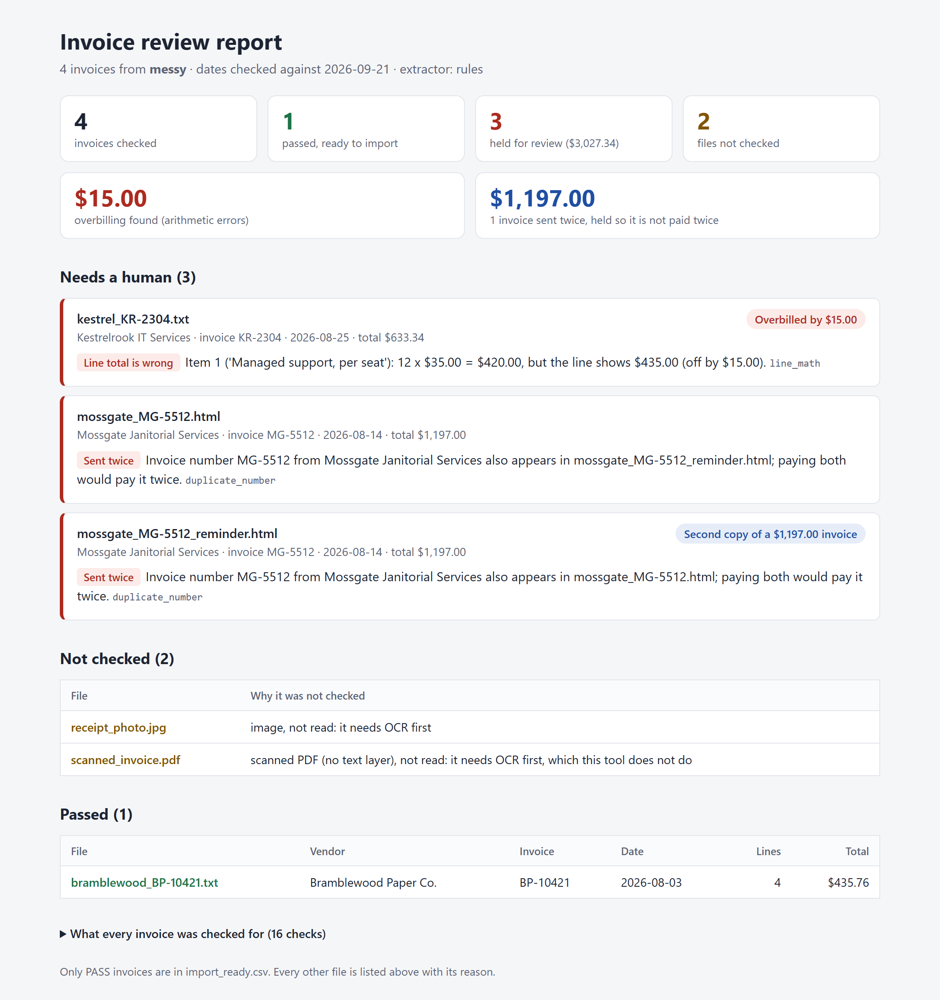

# Invoice checker: catches billing mistakes before you pay them

*Folder `invoice-extractor-verified`, command `invoicecheck`. Python standard library only; reading PDF invoices also needs the free pypdf package. MIT licensed.*

Most supplier invoices are right, which is why the wrong ones get paid without a second look: a line that doesn't multiply out, a subtotal with two digits swapped, the same invoice sent again as a "payment reminder". This tool reads a folder of invoices, redoes every sum, compares the invoices with each other, and holds back anything that doesn't check out, with the reason in plain words. Only the invoices that pass go into the file your accounting software imports — plus any a named person has looked at and approved.

**On the 10 sample invoices in this folder** (synthetic, with 6 mistakes planted on purpose):

- **7 held for review, 3 passed, in about a second.** All 6 planted mistakes were caught, and the 3 clean invoices passed.
- **$34.00 of overbilling found:** $9.00 + $15.00 + $10.00 in sums that don't add up. One more held invoice charges $5.96 too *little* tax. It is held, but not counted as overbilling.
- **A $1,197.00 invoice sent twice was caught.** The second copy came as a "payment reminder". Both copies are held, so it is not paid twice. This is not counted as overbilling, because nothing on the invoice is wrong. It is why 6 mistakes hold 7 invoices.
- **Works offline by default.** Your invoices never leave your computer unless you switch on the optional AI step, which runs on your own Anthropic API key. There is no subscription.
- **Reads text, HTML and PDF invoices.** PDFs are read through their text layer (the words you can select), which needs pypdf. Without pypdf, each PDF is listed as NOT CHECKED with the reason "install pypdf to read PDF invoices". Scanned PDFs and photos need OCR, which this tool doesn't do, so they are listed as NOT CHECKED too. No file is ever skipped quietly.
- **An exceptions list, an import template and a review queue.** Every flag gets a row in `exceptions.csv` with its reason and the money at stake. A small mapping file renames and reorders the import file's columns to match your accounting software. And a person can approve a held invoice by name, so the next run imports it — except a possible duplicate, which no approval can release.
- **275 automated tests.** The rules were also broken on purpose, 101 different ways, and the tests caught every break.



*The review report from that run: [`example_output/review_report.html`](example_output/review_report.html). The other outputs are in [`example_output/`](example_output/).*

## Try it

1. Install Python from [python.org](https://www.python.org/downloads/). This has been tested on Python 3.14. Nothing else is needed for text and HTML invoices. To read PDF invoices, also run `pip install pypdf` (tested with pypdf 6.19.0).
2. Download this folder and open a terminal inside it.
3. Run `python -m invoicecheck run --input samples/ --out out/ --today 2026-09-21` (on a Mac, type `python3`).

Then open `out/review_report.html` in a browser. `--today` fixes the date the invoice dates are checked against, so the result matches this page whenever you run it. For real invoices, leave it out and today's date is used.

The terminal shows:

```
invoicecheck: 10 invoices from samples/ (extractor: rules, dates checked against 2026-09-21)
  PASS          bramblewood_BP-10421.txt        BP-10421       435.76
  NEEDS REVIEW  bramblewood_BP-10437.txt        BP-10437      1095.45  items don't add up
  PASS          kestrel_KR-2291.txt             KR-2291        889.85
  NEEDS REVIEW  kestrel_KR-2304.txt             KR-2304        633.34  line total is wrong
  NEEDS REVIEW  kestrel_KR-2310.txt             KR-2310        792.88  date in the future, due before it was issued
  PASS          lanternfish_LF-0087.html        LF-0087       1350.05
  NEEDS REVIEW  lanternfish_LF-0091.html        LF-0091        735.48  tax doesn't match its rate
  NEEDS REVIEW  mossgate_MG-5498.html           MG-5498        992.80  total is wrong
  NEEDS REVIEW  mossgate_MG-5512.html           MG-5512       1197.00  sent twice
  NEEDS REVIEW  mossgate_MG-5512_reminder.html  MG-5512       1197.00  sent twice
3 PASS, 7 NEEDS REVIEW, 0 NOT CHECKED
Held for review: 7 invoices totalling $6,643.95. Overbilling found: $34.00 in arithmetic errors.
Sent twice: a $1,197.00 invoice, held so it is not paid twice.
Wrote out/import_ready.csv (12 line rows from 3 PASS invoices)
Wrote out/all_invoices.csv
Wrote out/exceptions.csv (8 rows, one per flag)
Wrote out/review_report.html
Wrote out/review_report.md
Wrote out/results.json
```

Each planted mistake, and what was said about it, is listed in [docs/samples.md](docs/samples.md). KR-2310 gets two reasons because its mistyped year also puts it after its own due date.

## PDF invoices

[`pdf_samples/`](pdf_samples/) holds two PDF invoices: a clean one, and one with a line total that has two digits swapped. With pypdf installed, `python -m invoicecheck run --input pdf_samples/ --out out/pdf/ --today 2026-09-21` shows (the "Wrote" lines are left out):

```
invoicecheck: 2 invoices from pdf_samples/ (extractor: rules, dates checked against 2026-09-21)
  PASS          tumblewick_TW-3301.pdf  TW-3301        477.00
  NEEDS REVIEW  tumblewick_TW-3318.pdf  TW-3318        254.93  line total is wrong
1 PASS, 1 NEEDS REVIEW, 0 NOT CHECKED
Held for review: 1 invoice totalling $254.93. Overbilling found: $1.80 in arithmetic errors.
```

The report gives the reason: 2 x $36.75 = $73.50, but the line shows $75.30 (off by $1.80).

The text layer of a PDF goes through exactly the same checks as a `.txt` invoice. It is read with the words kept where they sit on the page, so an items table comes out as columns. That matters because a PDF often places each label and amount on the page separately, with no spaces between the columns. The two samples are built that way, and read without their positions, their item rows run together and none of them can be read.

Without pypdf, the same folder gives this, and nothing is written:

```
error: no invoices it could read in pdf_samples
  NOT CHECKED  tumblewick_TW-3301.pdf  (install pypdf to read PDF invoices)
  NOT CHECKED  tumblewick_TW-3318.pdf  (install pypdf to read PDF invoices)
```

In a folder that also holds text or HTML invoices, those are checked as usual, and each PDF is a NOT CHECKED row with that one-line reason.

The two samples are written by [`tools/make_pdf_samples.py`](tools/make_pdf_samples.py), a short script that uses only the standard library. A test checks that the files in `pdf_samples/` are exactly what it writes.

## What comes out

A CSV file is a spreadsheet file: Excel and Google Sheets open it, and accounting software can import it.

| File | What it's for |
|---|---|
| [`review_report.html`](example_output/review_report.html) | The list a person works through, as a page to open in a browser (the picture above). |
| [`review_report.md`](example_output/review_report.md) | The same report as plain text. |
| [`all_invoices.csv`](example_output/all_invoices.csv) | One row per file, whatever its status, with every reason. `Overbilled` is the arithmetic overbilling. `SentTwiceAmount` is the invoice's total when the file is a second copy. `ApprovedBy` and `ApprovedAt` are filled in when a person approved it out of the review queue. |
| [`exceptions.csv`](example_output/exceptions.csv) | **The exceptions list: one row per flag**, with its reason in plain words and the money at stake. See below. |
| [`import_ready.csv`](example_output/import_ready.csv) | One row per line item, **PASS invoices only** (plus any a person approved), for importing. Dollar amounts have two decimals (`255.00`) and no $ sign or thousands commas. Dates look like `2026-08-03`. Quantities and unit prices are written as printed, so a `$0.125` unit price stays `0.125` and quantity x unit price still makes the line amount. |
| `import_ready_mapped.csv` | The same rows under your accounting software's own column names. Written only when `--import-map` is given. See below. |
| [`results.json`](example_output/results.json) | Everything read from every file, plus the findings, for another program to pick up. |

`example_output/` is exactly what the command above writes; a test fails if the two ever drift apart. To see the `.html` report as a page, download this folder and open the file in a browser.

## The exceptions list

`exceptions.csv` is the list a person works through in a spreadsheet, next to the report they read in a browser. **One row per flag, not per invoice.** An invoice held for three reasons gets three rows, so each reason has its own cell, its own money and its own check code, and none of them hides inside a cell with the other two. Sorting the sheet by `FindingDifference` puts the most expensive flags at the top; filtering on `Check` gives every invoice held for the same reason. The invoice's own totals repeat on each of its rows, so a pivot by invoice still adds up.

| Column | What it holds |
|---|---|
| `SourceFile`, `Status` | The file, and `NEEDS REVIEW`, `APPROVED` or `NOT CHECKED`. |
| `Vendor`, `InvoiceNumber`, `InvoiceDate`, `InvoiceTotal` | What the invoice says, so the row stands on its own. |
| `Check`, `Flag`, `Reason` | The check code (`line_math`), the same thing in plain words (`Line total is wrong`), and the full sentence with the figures. |
| `FindingDifference`, `DifferenceKind` | What this one flag is worth: the amount, and whether it is `overbilling`, an `undercharge`, or a `sent twice` copy's whole total. Empty when the flag is not about an amount (a date, say). |
| `InvoiceOverbilled`, `InvoiceSentTwice` | The invoice's own counted figures, repeated on each of its rows. |
| `ApprovedBy`, `ApprovedAt`, `ApprovedReason` | Who approved this invoice out of the review queue, when, and why. |
| `QueueNote` | Why an approval that was on file could **not** be used (see the review queue below). |

`FindingDifference` is each flag's own difference, so the column does **not** add up to the "Overbilling found" figure: that one nets the differences per invoice, drops the ones in your favour, and ignores invoices that were not fully read. Use `InvoiceOverbilled` if you want a column that does add up to it.

Files that could not be read are on the list too, one row each, with `Check` set to `not_checked` and the reason in `Reason`. They have no invoice figures, because nothing in them was checked. An invoice that passed every check is not on the list at all.

**It opens in a spreadsheet safely.** A cell that starts with `=`, `+`, `-`, `@`, a tab or a carriage return is a formula to Excel, LibreOffice and Google Sheets, so an invoice whose vendor name is `=cmd|'/c calc'!A1` can run something the moment the file is opened. Every free-text cell in every CSV this tool writes is prefixed with an apostrophe when it starts one of those characters, which forces the cell to text. Amounts are deliberately left alone: they come out of the same formatter as the rest (`-25.00` for a credit note) and have to stay numbers for the file to be worth anything. Commas, quotes and line breaks inside a cell are handled by Python's `csv` module, so the file reads back with exactly the columns it was written with.

## Matching your accounting software's import template

`import_ready.csv` uses this tool's own generic column names. `--import-map` writes a second file, `import_ready_mapped.csv`, with the names and the order your accounting software's bill import wants:

```
python -m invoicecheck run --input samples/ --out out/ --today 2026-09-21 --import-map docs/import_map_example.json
```

```
Wrote out/import_ready_mapped.csv (10 columns for "Example bill import")
  constant columns: AccountCode, TaxCode
  left out of the mapped file: Currency, LineNumber, InvoiceSubtotal, InvoiceTax, InvoiceTotal, SourceFile
  Only PASS invoices are in import_ready.csv. import_ready.csv keeps this tool's own column names; --history and the review queue read that one.
```

```
SupplierName,BillNumber,BillDate,DueDate,LineDescription,LineQuantity,LineUnitPrice,LineAmount,AccountCode,TaxCode
Bramblewood Paper Co.,BP-10421,2026-08-03,2026-09-02,"Copy paper, letter, 10-ream case",6,42.50,255.00,6000,PURCH-STD
```

The mapping is a small JSON file; [`docs/import_map_example.json`](docs/import_map_example.json) is the one above, and the run that produced this output used it.

```json
{
  "template": "Example bill import",
  "columns": [
    {"target": "SupplierName", "from": "Vendor"},
    {"target": "BillNumber", "from": "InvoiceNumber"},
    {"target": "LineAmount", "from": "LineAmount"},
    {"target": "AccountCode", "value": "6000"}
  ]
}
```

- **The order of the list is the order of the columns.**
- `from` copies one of this tool's columns. The names are the header row of `import_ready.csv`: `Vendor`, `InvoiceNumber`, `InvoiceDate`, `DueDate`, `Currency`, `LineNumber`, `Description`, `Quantity`, `UnitPrice`, `LineAmount`, `InvoiceSubtotal`, `InvoiceTax`, `InvoiceTotal`, `SourceFile`.
- `value` writes the same text on every row, for a field the invoice does not carry: an expense account code, a tax code, a currency.
- **Leaving a column out of the list leaves it out of the file.** The run prints which ones those were, so nothing goes missing quietly.
- `template` is just a name for your own reference, printed with the file.

**A mistake in the mapping stops the run before a single file is written.** A `from` naming a column that does not exist is an error, not a blank column, because a silently empty `LineUnitPrice` imports as zero. So is a mistyped key (`"form"` for `"from"`), the same target column twice, and a column with both a `from` and a `value` or with neither. Each error names the column number, what is wrong and, for an unknown name, the list of columns there are.

**Why JSON and not a CSV mapping.** A mapping has to say three different things per column — copy this one, write this constant, and (by leaving it out) drop it. A two-column CSV cannot tell "the column named Vendor" from "the constant text Vendor", so it would need a third column of kinds, which is a small format of its own with nothing to check it against. JSON says it in one word per entry, keeps the order visible, and Python reports the exact line and column of a typo. It is also written once and then left alone, so it is not a spreadsheet job.

**`import_ready.csv` keeps its own column names on purpose.** `--history` and the review queue both read that file and look for `Vendor` and `InvoiceNumber`. If the mapping renamed them in place, a later run pointed at it would match nothing and the duplicate check would quietly stop working. It would not have failed; it would have found nothing. Handing a mapped file to `--history` is therefore an error that names the columns it found instead.

## The review queue

Some held invoices are fine once a person has looked at them: the vendor's line total really is the agreed price, the old date really is right. `approve` records that decision, and the next run puts the invoice in the import file.

```
python -m invoicecheck run --input samples/ --out out/ --today 2026-09-21

python -m invoicecheck approve --results out/results.json --file mossgate_MG-5498.html --by "Dana Fell" --note "Agreed fixed price with the vendor; they round the total up." --approvals out/review_queue.json
```

```
Approved mossgate_MG-5498.html (invoice MG-5498, 992.80) by Dana Fell at 2026-09-23T08:00:34+00:00
  it was held for: total is wrong
  reason given: Agreed fixed price with the vendor; they round the total up.
  written to out/review_queue.json (1 approval in the queue)
  the next run with --approvals out/review_queue.json puts it in the import file, unless the invoice has changed since
```

```
python -m invoicecheck run --input samples/ --out out/ --today 2026-09-21 --approvals out/review_queue.json
```

```
  APPROVED      mossgate_MG-5498.html           MG-5498        992.80  total is wrong
3 PASS, 1 APPROVED, 6 NEEDS REVIEW, 0 NOT CHECKED
Held for review: 6 invoices totalling $5,651.15. Overbilling found: $24.00 in arithmetic errors.
Sent twice: a $1,197.00 invoice, held so it is not paid twice.
Approved for import: 1 invoice totalling $992.80, including $10.00 of overbilling.
Wrote out/import_ready.csv (14 line rows from 3 PASS invoices and 1 a person approved)
```

Keep the queue file somewhere it is backed up, not in the output folder; `out/` is used above only so the example leaves nothing behind. The queue is the list in the report and in `exceptions.csv`; the command is how one line of it gets ticked off.

**Every approval says who, when and why it was held.** That is the whole point: an approval that does not name a person is not an audit trail. The queue file is `{"version": 1, "approvals": [...]}`, and this is the entry the command above wrote:

```json
{
  "file": "mossgate_MG-5498.html",
  "content_hash": "ec663044bcc85ca4c1a7082a5ce7c35d7bc7a1ce7eb5ac93f9a119e3f1562168",
  "approved_by": "Dana Fell",
  "approved_at": "2026-09-23T08:00:34+00:00",
  "held_for": ["total_math"],
  "held_reasons": ["[total_math] Subtotal $936.00 + tax $46.80 = $982.80, but the total says $992.80 (off by $10.00)."],
  "vendor": "Mossgate Janitorial Services",
  "invoice_number": "MG-5498",
  "total": "992.80",
  "note": "Agreed fixed price with the vendor; they round the total up."
}
```

The time is UTC, to the second, written with a `+00:00` offset rather than a `Z`, because `datetime.fromisoformat()` cannot read a trailing `Z` before Python 3.11 and this project runs on 3.10. A `Z` in a queue file written by something else is converted before it is read, so a file from a newer machine still works on an older one.

### What "the same invoice" means

`content_hash` is a SHA-256 of everything the extractor read from that file — vendor, invoice number, both dates, every line item, subtotal, tax, total, the extractor's own warnings, and which layout and extractor produced them — **except the file name**. An approval applies to the next run only if that hash still matches.

- **Change a figure and the approval stops applying.** The invoice is held again, and the report names the file that approval was written for: *"An approval for mossgate_MG-5498.html (approved by Dana Fell on 2026-09-23) was not used: the invoice has changed since it was approved, so it is held again."* It never carries over in silence.
- **Rename the file and the approval still applies.** The approval is about the numbers a person checked, not about a file name, and the same invoice saved under another name is the same invoice. The duplicate check below is what stops a second copy being paid.
- **Two files whose extracted contents are identical are one invoice here**, and one approval covers both. In practice they are also a duplicate, which no approval releases. The exception is a pair of files the extractor could read nothing from: they hash the same, so approving one approves both, and neither puts a line in the import file, because neither has any line items. **The audit trail is wrong in that case**: the approver's name, time and note are written against both files, in `all_invoices.csv`, `exceptions.csv` and both reports, so the record says someone approved a file they never opened. No money moves, and it has been left as it is on purpose — the alternative is to hash the file name too, which would void every approval the moment a file is renamed, the behaviour two lines up. Approve a file the tool could read nothing from and you are approving every other unreadable file in that folder; the fix for those is to make them readable, not to approve them.
- **An approval only covers the reasons it was given for.** `held_for` is checked against what this run found. Approve an invoice for `total_math`, and if a later run also finds it is 400 days old, the invoice is held again: *"...approved by Dana Fell on 2026-09-23 for total is wrong, but this run also found very old invoice, which that approval does not cover."*

### An approval never releases a possible duplicate

Paying an invoice twice is the expensive mistake this whole tool exists to prevent, so `duplicate_number`, `possible_duplicate` and `already_seen` cannot be approved away. There are three separate guards, and each one is broken on purpose in the mutation check:

1. **`approve` refuses to record it.** Nothing is written to the queue, and the message says what to do instead: check whether the earlier copy was paid, then remove this copy from the folder or take the earlier one out of the `--history` file. An approval that could never be used is worse than none, because somebody would think it had been dealt with.
2. **A run never applies one.** A second copy can turn up a month after the first was approved. If it does, both copies are held, and the report says: *"Approved by Dana Fell on 2026-09-23, but still held: sent twice. An approval never clears a possible duplicate, because paying an invoice twice is the mistake this check exists to stop."*
3. **A hand-edited queue file is rejected.** If an approval in the file lists one of those checks, the run stops with an error rather than using it.

An invoice that was approved and imported will also come back as `already_seen` the next time, if `--history` is pointed at the import file it went into — which is the right answer, because it has already been through.

### The rest of the command

`approve` reads `results.json` from the run the person actually reviewed, so the reasons it records are the reasons they saw. It refuses an invoice that passed every check (there is nothing to approve), a file name that was not in that run (it lists the held ones), an invoice that is already approved, and an empty `--by`. A second approval is added to the queue rather than written over it, and the file is replaced in one step so an interrupted run cannot truncate it. A queue file that is not valid JSON, or is missing a field, stops the run and names which approval is wrong.

## How the money figures are worked out

There are two figures, and they are never added together. A third appears only when the review queue is in use.

**Overbilling found** is money an invoice asks for beyond what its own figures support. For each held invoice, the tool adds up the "off by" amounts that its line, subtotal, tax and total checks found. It counts the result only when that is in the vendor's favour. A tax shortfall therefore counts nothing, and so does a wrong line that the subtotal ignored.

- Tax charged on an overbilled amount is not added, so the figure is a floor. The extra $9.00 on BP-10437, for example, also carried $0.65 of tax.
- An invoice that wasn't fully read counts nothing, because the difference may be a genuine charge the tool couldn't place (a shipping line, say, or an unreadable row). A `possible_duplicate` also counts nothing.

**Sent twice** is an invoice that arrived more than once: the later file with the same vendor and number, or an invoice already in the `--history` file. Every copy is held. The later copy shows its whole total ("Second copy of a $1,197.00 invoice"), because paying it too would pay that invoice twice. The first copy shows nothing extra, because paying it is just paying the invoice. If both copies carry the same arithmetic error, that overbilling is counted once, on the first copy.

**Approved for import** is the invoices a person took out of the review queue, with the overbilling among them named separately: *"Approved for import: 1 invoice totalling $992.80, including $10.00 of overbilling."* Both figures above cover what is **still held**, so approving an invoice moves its money from "Overbilling found" to this line rather than making it disappear. On the ten samples, approving MG-5498 takes "Overbilling found" from $34.00 to $24.00 and puts the $10.00 here, with Dana Fell's name against it. Nothing stops a person approving an overbilled invoice; the report just says who did, and how much.

## Files it can't read

This run used a folder holding four of the samples, a scanned PDF and a photo (the "Wrote" lines are left out):

```
invoicecheck: 4 invoices from messy/, 2 other files not checked (extractor: rules, dates checked against 2026-09-21)
  PASS          bramblewood_BP-10421.txt        BP-10421       435.76
  NEEDS REVIEW  kestrel_KR-2304.txt             KR-2304        633.34  line total is wrong
  NEEDS REVIEW  mossgate_MG-5512.html           MG-5512       1197.00  sent twice
  NEEDS REVIEW  mossgate_MG-5512_reminder.html  MG-5512       1197.00  sent twice
  NOT CHECKED   receipt_photo.jpg               -                   -  image, not read: it needs OCR first
  NOT CHECKED   scanned_invoice.pdf             -                   -  scanned PDF (no text layer), not read: it needs OCR first, which this tool does not do
1 PASS, 3 NEEDS REVIEW, 2 NOT CHECKED
Held for review: 3 invoices totalling $3,027.34. Overbilling found: $15.00 in arithmetic errors.
Sent twice: a $1,197.00 invoice, held so it is not paid twice.
```

The scanned PDF is a page holding an image and no text, written by `python tools/make_pdf_samples.py --scan messy/scanned_invoice.pdf`. A PDF that is damaged, password-protected or has no pages is also listed as NOT CHECKED, with that reason. So is an encrypted PDF on a machine without the cryptography package, which pypdf needs to open it; the reason names the package.

The two files also appear in a "Not checked" table in both reports, as NOT CHECKED rows in `all_invoices.csv` and in a `not_checked` list in `results.json`. `--fail-on-review` treats them like review items: a folder where every invoice passed but one PDF was skipped still exits with status 3. Only hidden files (including the `._` files a Mac can leave beside each file on a shared drive or in a zip) and system clutter (`Thumbs.db`, `desktop.ini`, Office `~$` lock files) are left off the list. A file that isn't valid UTF-8 text is read with its unreadable characters replaced, and held for review with a note saying so.



## Setting it up for your business

**What you send:** two or three invoices from each regular supplier. You can black out names and amounts, as long as the layout survives. Also send the name of your accounting software with its bill-import template, and your sales tax rate or rates.

**What gets built and tested:**

- **Your suppliers' layouts.** Layouts are recognised by their structure, not by the supplier's name, so a supplier whose invoices use one of the four layouts it reads needs nothing new. That includes PDFs whose text layer comes out in one of them. A layout that doesn't match gets three things:
  - a detector and parser in `invoicecheck/extract_rules.py`;
  - one of your invoices as a sample, with its expected verdict in `tests/test_end_to_end.py`;
  - a mutant in `tools/mutation_check.py`, which proves the tests notice if that parser breaks.
- **Scans and photos.** These need OCR first, and that is a separate program; the same checks then run on its text. Unusual layouts that the rules can't read can go to the optional AI step (`--extractor auto`), which runs on your own Anthropic API key. That step reads text, not images, and every amount and quantity it returns, plus the invoice number, must be printed in the document.
- **The import file** is renamed and reordered to match your software's bill-import template, with a mapping file you keep and can change yourself (see [above](#matching-your-accounting-softwares-import-template)). A typical mapping:

  | `import_ready.csv` column | Typical bill-import field |
  |---|---|
  | Vendor | Supplier, Vendor or Contact name |
  | InvoiceNumber | Bill number or Reference |
  | InvoiceDate, DueDate | Bill date, Due date |
  | Description, Quantity, UnitPrice, LineAmount | Line description, Quantity, Unit price, Line amount |
  | InvoiceTax | usually a tax code on each line instead |
  | (not in the file) | Expense account or category. One code for every line is a `value` constant in the mapping file; a different code per supplier is set up as a rule during setup. |

  These are common field names, not a tested mapping: the file hasn't been run through any specific product's importer, so the template you send decides.
- **A scheduled run**, for example weekly, through Windows Task Scheduler or cron. It checks the folder where invoices land, with three settings:
  - `--fail-on-review`, so the job signals when something needs a person. An invoice a person has already approved does not hold the job up;
  - `--history`, pointed at the invoices already imported, so an invoice that comes back later is caught as `already_seen`;
  - `--approvals`, pointed at your review queue, so last week's approvals are picked up this week.

**What you get back:** a hand-over run on your own invoices, plus the tests that keep it working. The run shows each supplier's invoices passing, and a mistake planted in a copy of each one being caught.

## How it's tested

`python -m unittest` runs 275 tests in about 6 seconds, with no network access. (The test modules import each other with relative imports, so `unittest discover` needs the project root as its top level: `python -m unittest discover -s tests -t .`. Plain `python -m unittest` from this folder is the short form.) Every test of the three features below drives `main()`, the same entry point the terminal calls, rather than the helper underneath it:

- Every check on both sides of its line. A one-cent difference passes and two cents fails. A $0.01 total passes and $0.00 fails. An invoice 365 days old passes, and one 366 days old fails.
- Each of the four layouts, including every kind of unreadable row becoming a note instead of being dropped.
- The whole pipeline on the samples:
  - the exact verdict and reasons for all ten, the $34.00 overbilling figure, and the $1,197.00 invoice sent twice reported apart from it in every output;
  - only the three PASS invoices in the import file, with line amounts that add up exactly to each subtotal;
  - resent copies with a banner line on top still caught as duplicates;
  - files it can't read listed as NOT CHECKED, and a non-UTF-8 file held for review;
  - the folder path of the invoices never appears in the outputs, and output paths are printed relative to the working directory, even when `--out` is an absolute path elsewhere on the same drive.
- PDFs:
  - the two PDF samples, field by field, with the clean one passing and the planted $1.80 caught;
  - a scanned PDF, a damaged one, a password-protected one, an encrypted one that needs another package, and one with no pages, each listed as NOT CHECKED with its reason;
  - a whole run in a Python where `import pypdf` fails, where each PDF gets "install pypdf to read PDF invoices";
  - pypdf loaded only when a folder holds a PDF, because loading it takes longer than checking the ten samples.

  The 10 tests that read a PDF need pypdf. Without it they are skipped, each with the message "pypdf is not installed, so the tests that read a PDF are skipped (pip install pypdf to run them)". The other 265 tests still run and pass — checked by running the suite on a Python that does not have pypdf, which reported `OK (skipped=10)`.
- The exceptions list (`tests/test_exceptions.py`): one row per flag and two rows for the invoice with two reasons; an undercharge marked as one and not as overbilling; the second copy's whole total; a file that could not be read on the list with its reason; a clean folder still writing the headings. An invoice whose vendor really is `=cmd|'/c calc'!A1` and whose description is `+SUM(A1:A9)` is run through the CLI, and every cell of all three CSVs is checked not to start with a formula character — while a credit note's `-25.00` total is still read back by `float()`. A vendor name holding a comma and a double quote comes back out of a plain CSV reader intact, in a file with the right number of columns.
- The import mapping (`tests/test_import_map.py`): the columns renamed, reordered and topped up with constants, using the very mapping file the README points at, so the two cannot drift apart; the mapped file having the same rows in the same order as the import file; an approved invoice reaching it too. Every way a mapping can be wrong is driven through the CLI and has to produce a message and write nothing: an unknown `from`, a mistyped key, both or neither of `from` and `value`, a repeated target, an empty list, a bad top-level key and a file that is not JSON. Handing the mapped file back as `--history` is an error; handing back the unmapped one still flags the invoices as `already_seen`.
- The review queue (`tests/test_review_queue.py`): the whole run -> approve -> run round trip, ending with the invoice `APPROVED`, in the import file and in the mapped one, with who, when and why in the summary CSV, the exceptions list, both reports and the JSON. Then the ways it must fail: a changed invoice, an approval that does not cover a new reason, a renamed file that still counts as the same invoice, a duplicate `approve` refuses to record, a second copy that turns up later and holds an approved invoice anyway, a queue file hand-edited to approve a duplicate, an empty `--by`, approving something that passed, approving twice, and a queue file that is not JSON or is missing a field. Both sentences that name the approver are asserted whole, name included, in the terminal output, `results.json` and both reports, and the held-duplicate one in the exceptions list as well — the name used to be run through `str.capitalize()`, which printed "Approved by dana fell", and the tests asserted only the tail of the sentence, so nothing went red.
- The Python floor (`tests/test_python_floor.py`): the package source read for anything that does not exist on Python 3.10, and for a `datetime.fromisoformat()` call that has not had a trailing `Z` converted first. The checker is validated against a table of source that must be caught — all seven names, each in both import spellings and in its renamed forms — and source that must not be, so a checker that had stopped catching anything would not pass as green. Separately, in `tests/test_end_to_end.py`, `--today` is driven through the CLI with `20260923` and `2026-W39-3`, which Python 3.11 reads and 3.10 does not, and it has to refuse both. See the Limitations: this is a source check, not a run on 3.10.
- `--out` pointed at something that is not a folder (`tests/test_end_to_end.py`): a path that is a file, and a path with a file part-way up it. Both have to print a message and exit 2. The first used to be a `FileExistsError` traceback.
- A seeded batch of 80 random invoices (82 files) in all four layouts, with every kind of planted mistake, scored against its answer key. A second test breaks the answer key on purpose, to prove the scoring can fail.
- `example_output/` must match a fresh run line for line. To regenerate it after a change, run `python -m invoicecheck run --input samples/ --out example_output/ --today 2026-09-21`.
- The optional AI path, against response fixtures with a fake network layer.

A passing suite only means something if it fails when the code is broken. `python tools/mutation_check.py` copies the project to a temporary folder, breaks one rule at a time, and runs the suite against each break. The breaks include widening a tolerance, dropping an unreadable file without a word, adding an invoice sent twice into the overbilling figure, reading a PDF without keeping its columns, letting a review invoice into the import file and putting the API key in the request body. Each rule added for the three features above has its own break: the exceptions list keeping only the first flag per invoice, formula characters left runnable in the CSVs, amounts escaped so they stop being numbers, an import map accepting a column that does not exist or a mistyped key, the mapping written over `import_ready.csv` itself, a history CSV with no invoice numbers read as an empty history, and — three separate ones — each of the guards that stop an approval releasing a possible duplicate. One break removes the trailing `Z` conversion, which is the only way to pin that rule on an interpreter new enough not to need it. Nine more come from the defects an audit found on 2026-09-23: five ship a 3.11-or-later name inside the package — `from datetime import UTC`, `from typing import Self`, `from hashlib import file_digest`, and `itertools.batched` and `datetime.UTC` reached through a module and a renamed one — which the floor test has to notice; one points `--out` at a file; one makes an output folder that cannot be created crash instead of explaining; one lets `--today` take the spellings Python 3.10 rejects; and one puts `str.capitalize()` back on the approver's name. The current result is `101/101 mutants killed`.

At scale, `python tools/benchmark.py` writes 1,000 random invoices in the four layouts and plants one of 7 kinds of mistake in about a third of them. It then checks them all and scores every verdict against the answer key:

```
Synthetic batch: 1,000 invoices (seed 1), 4 layouts, 1,048 files
  342 invoices have one planted mistake (7 kinds); each one sent twice adds a reminder copy
Should pass:    658 files -> 658 passed, 0 false alarms
Should be held: 390 files -> 390 held for the right reasons, 0 missed, 0 held for a different reason
Overbilling (arithmetic errors) planted $3,610.43, found $3,610.43
Sent twice: 48 invoices ($241,981.16) planted, 48 ($241,981.16) held so they are not paid twice
Checked in 8.91 s over the freshly written files, 1.68 s on a repeat run (1.60 s per 1,000 files)
```

The generator was written alongside the checker. So this shows the checks hold up across a thousand sets of random numbers; it does not show they can read layouts they have never seen. On the Windows machine that produced this, the first pass is much slower because opening each freshly written file is slow (a profile of that pass is mostly file opens). The repeat run is the checking itself. Timings vary from run to run; the verdict lines do not, because the batch is seeded.

## Limitations

- It reads `.txt`, `.html` and, with pypdf, `.pdf` files that have a text layer. Scans and photos are listed as NOT CHECKED, because there is no OCR.
- It reads four layouts with confidence. Anything else is held for review, or, with `--extractor auto` and your own Anthropic API key, sent to the optional AI step.
- A PDF's pages are read one after another as one text. Only one-page PDFs have been tested; an items table that carries on over a page break may need a parser change.
- It expects US-style invoices: one currency (USD, with symbols not validated), and slash dates read as month/day/year.
- It assumes one tax rate per invoice. An invoice that mixes taxable and tax-free lines is held, and a person decides.
- Shipping, fees, discounts and deposits in the totals aren't part of the arithmetic. The invoice is held, with a note naming the line.
- The mapped import file has not been run through any real accounting package's importer. The mapping does what it says — renames, reorders, drops and adds columns — but whether a given product accepts the result is decided during setup, with your template.
- Formula characters are neutralised by putting an apostrophe in front, and a leading apostrophe that came from a CSV usually stays visible in the cell (it is the typed-in-a-cell form that hides). That is deliberate: a vendor name that reads `'=cmd|'/c calc'!A1` is doing its job. The tests check the text of every cell; they have not been opened in Excel, LibreOffice or Google Sheets.
- The exceptions list and the review queue are files, not a web page. A person works through them in a spreadsheet or a browser and runs one command per approval; there is no inbox, no email and nothing to log in to. A queue file is one file on one machine: two people approving at the same time would need something with a database behind it.
- The review queue holds approvals, not rejections. There is no "reject" command, because an invoice that is not approved is already held.
- `--out` itself is checked — a path that is a file, or one with a file part-way up it, gets a message and status 2 — but an error part-way through writing the six output files is not. A folder that turns read-only between the check and the write, or a disk that fills up, would still end in a traceback, and could leave some of the six behind. Nothing is retried and nothing is rolled back.
- An approval is bound to what the extractor read, not to the file name, so two files whose extracted contents come out identical share one approval. That is the point when a file has been renamed; it is a wrong answer when the extractor could read nothing from either file, because then they match on emptiness and the approver's name is written onto the audit record of a file they never opened. No money moves — neither file has line items, so neither reaches the import file — but the record is false. See [What "the same invoice" means](#what-the-same-invoice-means). The answer to a file the tool cannot read is to make it readable, not to approve it.
- **Python 3.10 is the floor, and only 3.14 was available on the machine this was built on**, so the suite has not been run on 3.10 here. Two tests read the package source instead: one fails on any name that does not exist on 3.10 (`tomllib`, `itertools.batched`, `typing.Self`, `StrEnum`, `ExceptionGroup`, `datetime.UTC`, `hashlib.file_digest`), and one fails if `datetime.fromisoformat()` is ever called on text that has not had a trailing `Z` converted first. That is a source check, not a run on 3.10.
  - What the source check covers, exactly: each of those seven names written either way — `import datetime` then `datetime.UTC`, and `from datetime import UTC` — including through a renamed module (`import datetime as dt`) or a renamed name (`from typing import Self as S`). It is a static read of `invoicecheck/*.py` only — the package that runs on your server. `tests/` and `tools/` are not part of that scan; the same checker was pointed at both by hand on 2026-09-23 and found nothing, but nothing keeps them clean automatically. It also cannot follow a name through a variable, a `getattr()` or an `__import__()`. Those are the holes left in it. The checker is itself tested against a table of source that must be caught and source that must not, rather than being trusted because it is green: an earlier version advertised all seven, and `from datetime import UTC`, `from typing import Self` and `from hashlib import file_digest` all went straight through it, because it looked for those three only in the `datetime.UTC` spelling. `itertools.batched` written as an attribute went through for the mirror-image reason. Four gaps in a seven-item list, in the test sold as the floor's protection.
  - The one other place 3.10 and 3.11 differ at run time is `date.fromisoformat()`, which 3.11 widened to read `20260923` and week dates. `--today` is pinned to `YYYY-MM-DD` in the CLI itself, so the same command means the same thing on both, and `--today 20260923` is refused on every version rather than being accepted here and refused on the client's Ubuntu 22.04.

## Reference

### Options

| Option | Default | Meaning |
|---|---|---|
| `--extractor rules\|ai\|auto` | `rules` | `rules` works offline. `ai` and `auto` switch on the optional AI step, which runs on your own Anthropic API key; see [AI extraction](#optional-ai-extraction-off-by-default-runs-on-your-own-anthropic-api-key). |
| `--today YYYY-MM-DD` | today | The date to check invoice dates against. That one spelling and no other, on every Python version: `20260923` and week dates are refused, so a command that works on your machine works on the server. |
| `--max-age-days N` | 365 | Flag invoices older than this. `0` turns it off. |
| `--history FILE` | none | A CSV from an earlier run (`import_ready.csv` or `all_invoices.csv`). An invoice already listed there is flagged `already_seen`. A CSV with no `InvoiceNumber` column is an error, not an empty history. |
| `--import-map FILE` | none | A JSON mapping (see [above](#matching-your-accounting-softwares-import-template)). Also writes `import_ready_mapped.csv` with your software's column names. A mistake in it stops the run before anything is written. |
| `--approvals FILE` | none | The review queue written by `approve`. A held invoice with a usable approval is marked `APPROVED` and goes into the import file. |
| `--fail-on-review` | off | Exit with status 3 when anything needs review or a file could not be checked, for use in a scheduled job. An `APPROVED` invoice does not trigger it. |

`run` also needs `--input FOLDER` and `--out FOLDER`. `--out` is created if it is not there, and re-used if it is. It has to be a folder. A path that is already a file is caught before any invoice is read, which matters with `--extractor ai`, where reading them costs money. A path with a file part-way up it cannot be seen until the folder is created, so that one is caught after the invoices have been read. Either way it is a message and status 2, and nothing is written.

To see what the extractor reads from one file, run `python -m invoicecheck extract samples/kestrel_KR-2291.txt`. It works on a PDF too.

### `approve`

`python -m invoicecheck approve --results out/results.json --file NAME --by "Your Name" --approvals queue.json [--note "why"]`

| Option | Meaning |
|---|---|
| `--results FILE` | The `results.json` from the run that held the invoice, so the reasons recorded are the ones the person saw. |
| `--file NAME` | The invoice's file name, exactly as the report shows it. A name that is not in that run lists the held ones. |
| `--by NAME` | Who is approving it. Free text, required, recorded with the time. An empty name is refused. |
| `--approvals FILE` | The queue file to add it to. Created if it does not exist; added to, never written over. |
| `--note TEXT` | Why, in your own words. Recorded with the approval and shown in the reports. |

### What gets checked

Every amount is a `Decimal`, never a float, so "subtotal + tax = total" is exact arithmetic. "Within a cent" means a difference of at most $0.01.

| Code | Shown as | The invoice is flagged when... |
|---|---|---|
| `extraction` | not fully read | the layout wasn't recognised, the file wasn't valid UTF-8, or the extractor hit something it couldn't account for. That covers an items-table row it couldn't read, an item-shaped row without cents, an item row below the totals, or an amount in the totals block that isn't a subtotal, tax or total (a shipping line, for example). The note names the line. |
| `required_fields` | details missing | the vendor, invoice number, invoice date, line items or total is missing, or the invoice date can't be read. |
| `line_incomplete` | line incomplete | a line has no amount, or has a quantity without a unit price (or the other way round). Lump-sum lines with only an amount are fine. |
| `line_math` | line total is wrong | quantity x unit price differs from the line amount by more than a cent. |
| `lines_sum` | items don't add up | the lines don't add up to the subtotal. If no subtotal is printed, the lines plus tax must make the total. |
| `tax_rate` | tax doesn't match its rate | a rate is printed and the tax isn't that rate of the subtotal. The tolerance is one cent per two lines, to allow for tax rounded line by line. |
| `total_math` | total is wrong | subtotal + tax differs from the total by more than a cent. |
| `total_not_positive` | zero or negative total | the total is zero or negative. Credit notes are left to a person. |
| `date_future` | date in the future | the invoice date is after the run date. |
| `date_stale` | very old invoice | the invoice date is older than `--max-age-days`. |
| `date_unreadable` | due date unreadable | a due date is printed but can't be read. |
| `due_before_issue` | due before it was issued | the due date is earlier than the invoice date. |
| `duplicate_number` | sent twice | another file in the batch has the same vendor and invoice number. Case, spaces, hyphens and suffixes like "LLC" are ignored, so `MG-5512` from "Mossgate LLC" matches `mg 5512` from "MOSSGATE". |
| `possible_duplicate` | may be a duplicate | another file has the same vendor, date and total under a different invoice number. It also fires when the same invoice number has the same total or date under a different vendor name (one invoice whose vendor was read two ways). Two genuinely different vendors can trip this; a person clears it. |
| `already_seen` | seen in an earlier run | the vendor and number are in the `--history` file. Duplicates are found within a batch and against that file; there is no database. |
| `not_in_source` | number not on the page | (optional AI step only) an amount, quantity or the invoice number the model returned isn't printed anywhere in the document. |

One more code turns up in the reports and in the `Reasons` column: `review_queue`. It is not a check, and it never holds an invoice on its own. It is the note saying why an approval that was on file could not be used — see [The review queue](#the-review-queue).

### How extraction works

The rules extractor recognises a layout by its structure, not by the vendor's name, so a vendor whose invoices use one of these layouts doesn't need a parser of its own. The samples cover four layouts:

| Layout | Samples | How it's recognised |
|---|---|---|
| `text-columns` | Bramblewood, and the Tumblewick PDFs | a column header line (`Description ... Qty ... Unit Price ... Amount`) with whitespace-aligned rows. Unit prices and amounts need cents (`15.00`, not `15`); a row without them is flagged as unreadable, not guessed at. |
| `text-pipe-table` | Kestrelrook | a `\| ... \|` table whose header names a description, quantity, price and amount column. Columns are matched by header name, so an extra SKU column doesn't matter. |
| `html-table` | Lanternfish | an HTML table with those headers (every such table on the page is read). Totals come from `<tfoot>`, or from paragraphs, two-cell rows or `<dt>/<dd>` pairs elsewhere on the page. |
| `html-list` | Mossgate | list items shaped like `4 x Nightly office clean @ $210.00 = $840.00` |

A PDF is read as text: pypdf's layout mode places each word where it sits on the page, so the columns of an items table stay apart, and the result goes to the same text parsers. If layout mode fails on a page (some fonts defeat it), that page is read in pypdf's plain mode instead.

Header fields (invoice number, invoice date, due date) come from labels like `Invoice #`, `Invoice No.`, `Issued` and `Payment due`. These are found in text lines, two-cell table rows or `<dt>/<dd>` pairs. A specific label (`Invoice Date`, `Issued`) wins over a bare `Date` wherever they appear. A bare `Date` or `Due` only counts when a separator or a date follows it, so `Date of service:` isn't read as the invoice date. Dates are accepted in ISO, `08/11/2026` (read as month/day/year), `August 20, 2026` and `14 Aug 2026` styles.

The vendor name matters because the duplicate checks match on it. In text files, it's a labelled value (`Vendor:`, `Supplier:`, `Sold by:`) if there is one, otherwise the first line above the items that isn't a banner. In HTML, the extractor looks for an element with a `vendor` or `company` class, then a labelled value, then the first `<h1>`/`<h2>` that isn't a banner. Banner lines like `INVOICE`, `COPY`, `PAYMENT REMINDER - SECOND NOTICE` and `Page 1 of 2` are skipped, so a resent copy gets the same vendor as the original. Banners are recognised from a word list (invoice, copy, reminder, notice, page and so on), so a banner worded some other way could still be taken as the vendor. The cross-vendor `possible_duplicate` check then catches the resend only if the invoice number and the total or date match.

Anything else goes to a generic fallback that reads what it can. The invoice is always flagged, because the fallback is a guess.

### Optional AI extraction (off by default, runs on your own Anthropic API key)

This step is optional and off by default. The tool is fully usable without it, and without it nothing leaves your computer.

- `--extractor ai` sends every file to the Anthropic Messages API.
- `--extractor auto` uses the rules extractor first and calls the API only for files it couldn't fully read (an unrecognised layout, or an unreadable row). On the samples, that's none of them.

It runs on your own Anthropic API key, set as `ANTHROPIC_API_KEY` in the environment, and any usage is billed to that key. The key is read when the tool runs and only ever goes in the request header. It isn't written to disk, logged, or included in error messages, and a test checks that it never appears in the request body. `--extractor ai` without a key stops with an error and does nothing. `auto` without a key keeps the rules result and adds a note saying the AI step was skipped.

The request goes through `urllib` (no SDK) to `claude-opus-5` by default (`--model` changes it). It asks for structured JSON output against a fixed schema, and the result is mapped onto the same invoice schema the rules extractor produces. The prompt tells the model to **transcribe, not correct**. A model that helpfully fixes a wrong line total would hide the very error this tool exists to catch.

AI output goes through every check above, plus one more: `not_in_source`. A model can return numbers that add up perfectly and still aren't on the page. The arithmetic checks can't catch that, so every amount it returns has to appear in the source document. `tests/test_extract_ai.py` has a case where the model "corrects" KR-2304 so that all the sums work. There, `line_math` stops firing, and `not_in_source` catches the four invented numbers instead.

Status: this path has not been run against the live API. The tests cover request building, response parsing, refusals, truncated responses, retries on 429/5xx/529, read timeouts, dropped connections and error handling. They run against fixture responses in `tests/fixtures/`, written by hand in the documented Messages API response format rather than captured from a real call. No test touches the network. Any failure on this path becomes a review item for that file rather than stopping the run. In one test every call times out, and the run still writes all its outputs, with all ten files marked NEEDS REVIEW.

### Code layout

```
invoicecheck/
  cli.py            command line (run, extract)
  documents.py      loading .txt / .html / .pdf files; every other file listed as NOT CHECKED
  pdftext.py        a PDF's text layer through pypdf, loaded only when a PDF turns up
  htmldoc.py        small HTML tree on html.parser
  extract_rules.py  layout detection and the four parsers + fallback
  extract_ai.py     optional AI extractor on your own Anthropic API key (urllib)
  model.py          the invoice schema both extractors produce
  verify.py         every check, PASS / NEEDS REVIEW, overbilling and invoices sent twice
  review.py         the review queue: approvals, what "the same invoice" means
  importmap.py      the mapping onto your accounting software's import columns
  outputs.py        the CSVs, the review report (HTML and Markdown) and JSON
  textutil.py       money, quantity and date parsing (Decimal throughout)
samples/            ten synthetic invoices, four layouts (described in docs/samples.md)
pdf_samples/        two synthetic PDF invoices, written by tools/make_pdf_samples.py
example_output/     what the quick-start command writes
docs/               the sample descriptions, the two report screenshots, and an example import map
tests/              unittest suite, fixtures and the synthetic batch generator
tools/              mutation check, benchmark and the PDF sample writer
```

### License

MIT. See [LICENSE](LICENSE).

Hire me on Upwork: [my Upwork profile](https://www.upwork.com/freelancers/~0102c9da1a58bd5441)

Want your own invoices done this way? Order it as a fixed-price project: [your invoice PDFs into Excel, every total checked](https://www.upwork.com/services/product/development-it-invoice-data-extracted-into-a-spreadsheet-with-totals-checked-2102654749501770828?ref=project_share)
